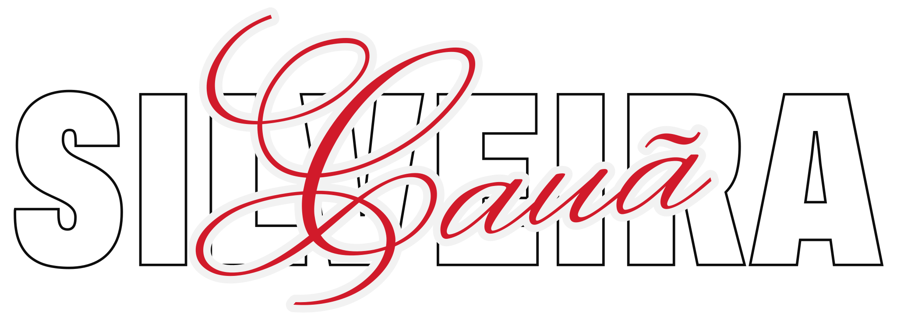
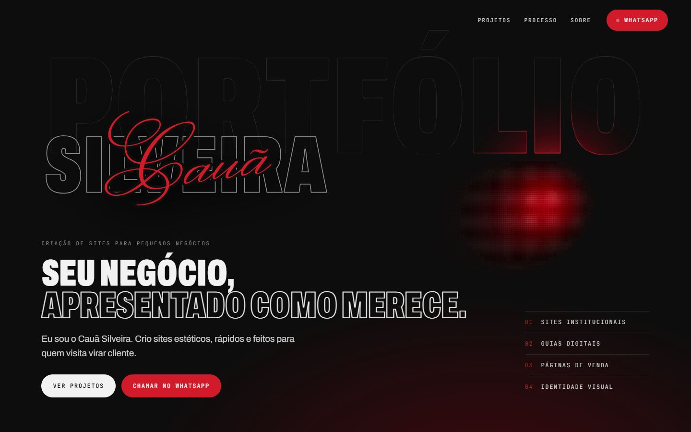
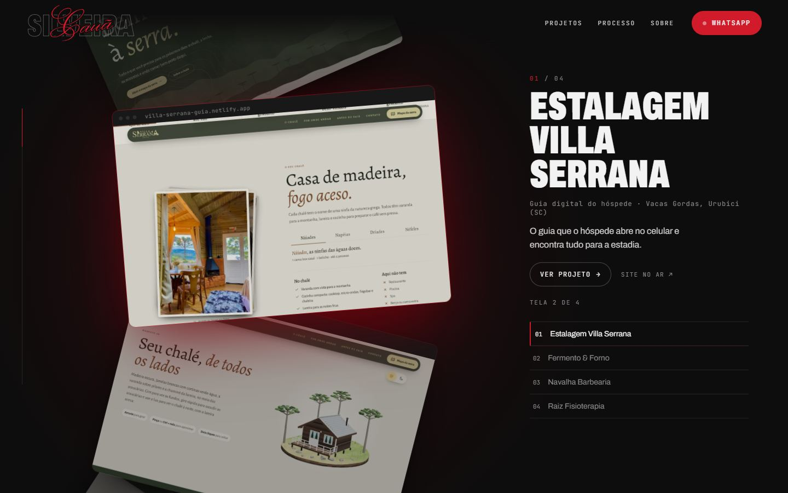
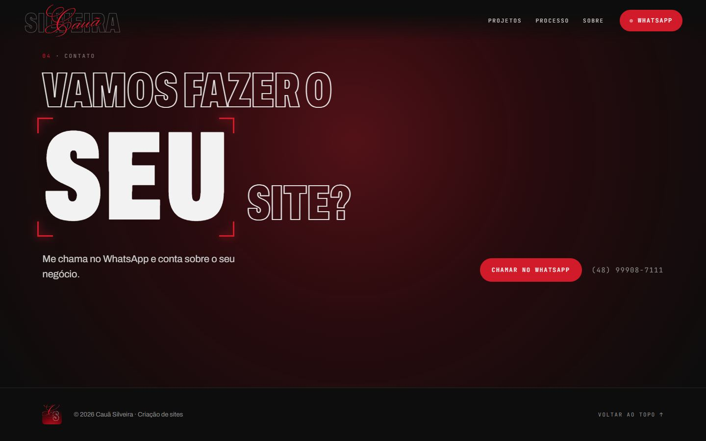
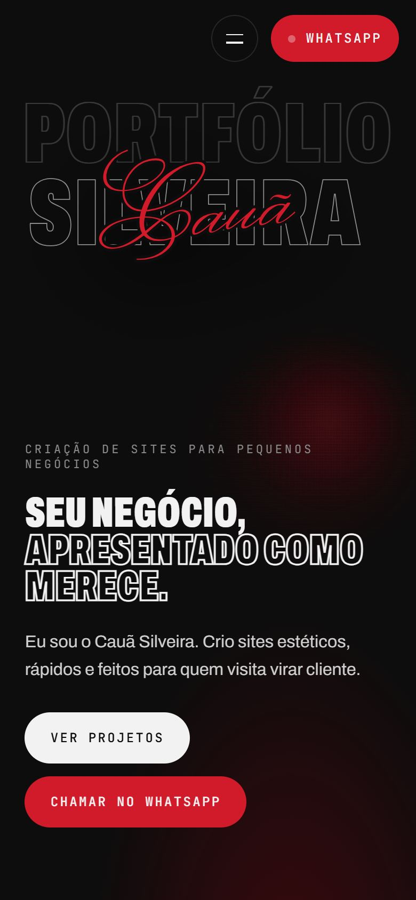

<p align="center">
  <picture>
    <source media="(prefers-color-scheme: dark)" srcset="identidade-visual/assets/logo.svg">
    
  </picture>
</p>

<p align="center">
  Portfólio de criação de sites para pequenos negócios.<br>
  <a href="https://caua-silveira.netlify.app"><strong>caua-silveira.netlify.app</strong></a>
</p>

---

| Topo | Vitrine de projetos |
| --- | --- |
|  |  |
| **Contato** | **Celular** |
|  |  |

## O que o site faz

- **Abertura** com o logo: o SILVEIRA sobe do desfoque, a assinatura "Cauã" é escrita à mão, contorno a contorno, e o nome voa até o lugar dele no topo. Aparece uma vez por sessão e tem botão para pular.
- **Topo** com a palavra PORTFÓLIO gigante, vazada, que se acende em vermelho onde passa a luz do cursor (ou do dedo), com uma fumaça vinho que deixa rastro.
- **Vitrine em roda**: cada tela de cada site é um card preso a uma roda que gira com a rolagem; o card em foco abre a página do projeto.
- **Processo** em quatro etapas, cada uma com uma pequena cena animada.
- **Contato** com o WhatsApp sempre à mão, também no cabeçalho fixo.
- **Uma página por projeto**, com todas as telas no computador e no celular.
- Troca de página com uma cortina em que o monograma **CS** se desenha e se apaga.
- Funciona no celular e respeita a preferência de movimento reduzido do sistema.

## Como rodar

```bash
cd site
npm install
npm run dev
```

Para gerar a versão de publicação: `npm run build` (sai em `site/dist`).

## Como adicionar um projeto

1. Coloque as telas em `site/public/projetos/<nome-do-projeto>/` em webp (1600 px de largura para computador, 600 px para celular).
2. Acrescente um item em `site/src/dados/projetos.js` com nome, tipo, local, resumo, link e a lista de telas.

A vitrine, a lista lateral e a página do projeto se montam sozinhas a partir desse arquivo. Projetos conceito levam `conceito: true` e aparecem marcados como tal.

## Estrutura

```
site/                 o site (Vite + React 18)
  public/             fontes, logo, telas dos projetos
  src/componentes/    abertura, topo, vitrine, seções
  src/dados/          lista de projetos
identidade-visual/    manual de marca (md e pdf), logo, monograma, fontes, textos
docs/                 plano do site e imagens deste README
```

## Marca

| Cor | Hex | Papel |
| --- | --- | --- |
| Preto-carvão | `#0D0D0D` | fundo |
| Branco-gelo | `#F2F2F2` | texto |
| Vinho profundo | `#73030D` | luz e superfícies |
| Vinho rosado | `#732F3B` | superfícies secundárias |
| Vermelho aceso | `#D11A2A` | títulos grandes, números e WhatsApp |
| Cinza-concreto | `#8C8C8C` | texto secundário |

Fontes: **Archivo** (condensada nos títulos, normal no texto), **JetBrains Mono** (rótulos e números) e **Monsieur La Doulaise** (só na assinatura do logo). O manual completo está em [`identidade-visual/manual-de-marca.pdf`](identidade-visual/manual-de-marca.pdf).

## Créditos

- Fontes Archivo, JetBrains Mono e Monsieur La Doulaise: Google Fonts, licença SIL Open Font License.
- Efeito do título do contato inspirado no componente TrueFocus do [React Bits](https://reactbits.dev).
- Telas da Estalagem Villa Serrana capturadas do [guia publicado](https://villa-serrana-guia.netlify.app).
- Fermento & Forno, Navalha Barbearia e Raiz Fisioterapia são projetos conceito, não sites de clientes reais.
